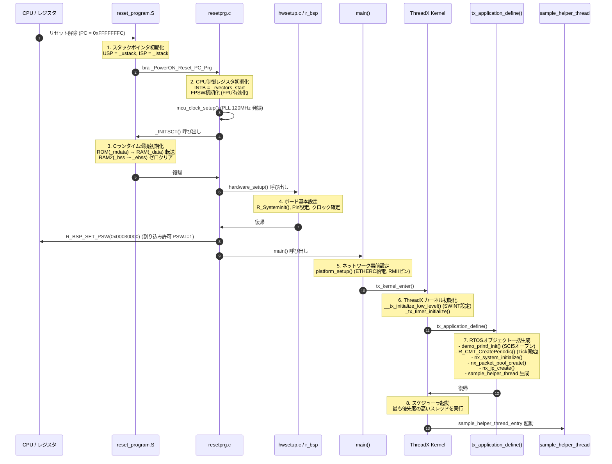

# マイコン向け Azure RTOS / Azure IoT 組み込みソフトウェア 基本設計書 (BASIC_DESIGN_SPECIFICATION)

---

# 改訂履歴

| 版数 | 発行日付 | 作成者 / 変更者 | 改訂内容要約 |
| :---: | :---: | :---: | :--- |
| 1.00 | 2026-10-10 | システム設計チーム | 新規作成（RX65N 向け Azure RTOS / Azure IoT 統合システム基本設計書 初版） |

---

# 第1章 システム概要およびハードウェア構成

## 1.1 システム開発目的・適用範囲
本書は、ルネサス エレクトロニクス製 32 ビットマイコン **RX65N** 上で、リアルタイムオペレーティングシステム **Azure RTOS（ThreadX）**、ネットワークスタック **NetX Duo**、暗号化スタック **NxSecure TLS 1.2**、および **Azure IoT Embedded SDK for C** を統合し、Microsoft Azure IoT Hub との高信頼・セキュアな双方向 MQTT 通信を実現する組み込みソフトウェアシステムの基本設計を定義する。

## 1.2 対象マイコン（RX65N）ハードウェア仕様
- **型番**: R5F565NEDDFP (RX65N-2MB 品)
- **CPUコア**: RXv2 コア（最高動作周波数 120 MHz、単精度 IEEE754 準拠 FPU 搭載、32ビット乗除算器内蔵）
- **動作電源電圧**: 2.7 V 〜 3.6 V
- **メモリ仕様**:
  - 内蔵コードフラッシュ (ROM): 2,097,152 バイト (2 MB, アドレス範囲 `0xFFE00000` 〜 `0xFFFFFFFF`)
  - 内蔵データフラッシュ: 32,768 バイト (32 KB, アドレス範囲 `0x00100000` 〜 `0x00107FFF`)
  - 内蔵高速 RAM: 262,144 バイト (256 KB, アドレス範囲 `0x00000004` 〜 `0x0003FFFF`)
  - 内蔵拡張 RAM (RAM2): 393,216 バイト (384 KB, アドレス範囲 `0x00800000` 〜 `0x0085FFFF`)
  - オプション設定メモリ (OFS): 128 バイト (アドレス範囲 `0xFE7F5D00` 〜 `0xFE7F5D7F`)
- **使用内蔵周辺モジュール**:
  - **ETHERC / EDMAC**: イーサネットコントローラおよび専用 DMA。RMII インターフェース経由で外部 PHY と通信。
  - **SCI5**: シリアルコミュニケーションインターフェース。非同期調歩同期式 UART 通信（115200 bps）。
  - **CMT0**: コンペアマッチタイマ（チャネル0）。RTOS システム Tick（100 Hz）生成用。
  - **ICU**: 割り込みコントローラ。ベクタ割り込み、優先度（IPL 0〜15）制御。
  - **MPC**: マルチファンクションピンコントローラ。端子機能割り当て。
  - **WDT / IWDT**: ウォッチドッグタイマおよび独立ウォッチドッグタイマ。

## 1.3 ハードウェア接続構成および端子配置仕様
マイコンと外部ペリフェラルの物理ピン配置仕様を下表に示す。

| 機能グループ | 端子番号/端子名 | 端子機能設定 (MPC) | 接続先デバイス | 信号説明 |
| :--- | :--- | :--- | :--- | :--- |
| **Ethernet (RMII)** | P71 / ET0_MDIO | `MPC.P71PFS.PSEL = 0x11` | PHY LSI (KSZ8081RNB 等) | マネジメントデータ入出力 |
| | P72 / ET0_MDC | `MPC.P72PFS.PSEL = 0x11` | PHY LSI | マネジメントデータクロック |
| | P74 / RMII0_TXD_EN | `MPC.P74PFS.PSEL = 0x12` | PHY LSI | 送信イネーブル |
| | P75 / RMII0_TXD0 | `MPC.P75PFS.PSEL = 0x12` | PHY LSI | 送信データ bit 0 |
| | P76 / RMII0_TXD1 | `MPC.P76PFS.PSEL = 0x12` | PHY LSI | 送信データ bit 1 |
| | P77 / RMII0_RX_ER | `MPC.P77PFS.PSEL = 0x12` | PHY LSI | 受信エラー通知 |
| | P80 / RMII0_RXD0 | `MPC.P80PFS.PSEL = 0x12` | PHY LSI | 受信データ bit 0 |
| | P81 / RMII0_RXD1 | `MPC.P81PFS.PSEL = 0x12` | PHY LSI | 受信データ bit 1 |
| | P82 / RMII0_CRS_DV | `MPC.P82PFS.PSEL = 0x12` | PHY LSI | キャリア検出 / 受信データ有効 |
| | P83 / ET0_REF50CK | `MPC.P83PFS.PSEL = 0x12` | PHY LSI (50MHz OSC) | RMII 50MHz 基準クロック入力 |
| **Serial (SCI5)** | PA4 / RXD5 | `MPC.PA4PFS.PSEL = 0x0A` | USB-UART 変換 IC | デバッグシリアル受信 |
| | PA3 / TXD5 | `MPC.PA3PFS.PSEL = 0x0A` | USB-UART 変換 IC | デバッグシリアル送信 |
| **Clock / Reset** | EXTAL / XTAL | 発振子接続 (24 MHz) | 水晶振動子 | メインクロック入力 |
| | RES# | プルアップ / リセット回路 | リセットスイッチ / JTAG | ハードウェアリセット入力 |

## 1.4 開発環境およびビルド設定
- **コンパイラ**: GCC for Renesas RX 14.2.0 (`rx-elf-gcc`)
- **コンパイラフラグ**:
  ```text
  -O2 -ffunction-sections -fdata-sections -fno-strict-aliasing -fdiagnostics-parseable-fixits
  -Wstack-usage=100 -g2 -m64bit-doubles -misa=v2 -mlittle-endian-data -std=gnu99
  ```
- **プリプロセッサ定義マクロ**:
  ```text
  -DNX_ENABLE_DHCP -DNXD_MQTT_CLOUD_ENABLE -DNX_SECURE_ENABLE
  -DNX_ENABLE_EXTENDED_NOTIFY_SUPPORT -DNX_ENABLE_IP_PACKET_FILTER
  -DFLATCC_NO_ASSERT -DNX_AZURE_IOT_LOG_LEVEL=0
  -DTX_INCLUDE_USER_DEFINE_FILE -DNX_INCLUDE_USER_DEFINE_FILE -DFX_INCLUDE_USER_DEFINE_FILE
  ```
- **リンカフラグ**:
  ```text
  -T "src/linker_script.ld" -Wl,--start-group -lm -lc -lgcc -Wl,--end-group
  -nostartfiles -Wl,-e_PowerON_Reset -Wl,--Map=azure_sdk.map
  ```

---

# 第2章 ソフトウェア全体アーキテクチャ

## 2.1 ソフトウェア階層構造
本ソフトウェアは、明確な責務分離を図るため以下のレイヤ構造を採用する。

```text
+-----------------------------------------------------------------------------------+
|                        アプリケーション層 (Application Layer)                      |
|  - main.c / sample_helper_thread (システム統括・ネットワークシーケンス)               |
|  - sample_azure_iot_embedded_sdk.c (Telemetry, C2D, Direct Method, Device Twin)   |
|  - sample_azure_iot_embedded_sdk_connect.c (指数バックオフ再接続・ネットワーク監視)   |
|  - demo_printf.c (排他UART出力・シリアルリダイレクト)                                 |
+-----------------------------------------------------------------------------------+
|                     ドライバ結合・抽象化層 (Driver Adapter Layer)                 |
|  - nx_driver_rx_fit.c (NetX Duo ↔ ETHERC/EDMAC ゼロコピーアダプタ)                  |
|  - nx_driver_rx_fit_callback.c (非同期リンクイベント処理・ブロックプール)           |
|  - hardware_setup.c (CMT0 Tick タイマ生成・ETHERC 給電初期化)                      |
+-----------------------------------------------------------------------------------+
|                   ミドルウェア層 (Azure RTOS & Azure IoT SDK)                     |
|  - Azure IoT Embedded C SDK (IoT Hub Client, Provisioning Client, MQTT, JSON)     |
|  - NxSecure TLS 1.2 (TLS ハンドシェイク, レコード層, X.509 証明書検証)             |
|  - NetX Duo Addons (DHCP Client, DNS Client, SNTP Client)                         |
|  - NetX Duo Core (IPv4, ARP, TCP, UDP, パケットプール管理)                          |
|  - ThreadX Core & RXv2 Port (プリエンプティブスケジューラ, タイマ, 同期オブジェクト)   |
+-----------------------------------------------------------------------------------+
|                        BSP & FIT ドライバ層 (Hardware Driver Layer)                |
|  - r_ether_rx (ETHERC/EDMAC レジスタ制御, バッファディスクリプタ管理)               |
|  - r_sci_rx / r_byteq (SCI5 UART 送受信, FIFOキュー)                                |
|  - r_cmt_rx (コンペアマッチタイマ周期割り込み)                                       |
|  - r_pincfg (端子機能 MPC レジスタ設定)                                            |
|  - r_bsp (クロック発振制御, スタートアップ, 低水準 Newlib I/O スタブ)               |
+-----------------------------------------------------------------------------------+
|                                 ハードウェア (RX65N)                              |
+-----------------------------------------------------------------------------------+
```

## 2.2 全体ブートシーケンスおよび実行制御フロー
マイコンのパワーオンリセットから各 RTOS タスクが稼働するまでの実行遷移シーケンスを定義する。



---

# 第3章 メモリ管理・リンカ配置設計

## 3.1 物理メモリ領域定義
RX65N 2MB 品の物理メモリマップに基づくメモリセグメント構成を以下に定義する。

```ld
MEMORY
{
    RAM  : ORIGIN = 0x00000004, LENGTH = 0x0003FFFC   /* 256KB - 4B (内蔵RAM) */
    RAM2 : ORIGIN = 0x00800000, LENGTH = 393216       /* 384KB (内蔵拡張RAM) */
    ROM  : ORIGIN = 0xFFE00000, LENGTH = 2097152      /* 2MB (内蔵コードフラッシュ) */
    OFS  : ORIGIN = 0xFE7F5D00, LENGTH = 128          /* 128B (オプション設定メモリ) */
}
```

## 3.2 セクション配置設計および DMA アクセス制約
ハードウェア DMA（EDMAC）のバスマスタ制約およびアライメント要件を厳密に満たすセクション配置設計を行う。

1. **EDMAC ディスクリプタおよびパケットバッファ配置**:
   - EDMAC は内蔵拡張 RAM（RAM2: `0x00800000`〜）へのバスマスタアクセスが不可（内蔵高速 RAM `0x00000000`〜`0x0003FFFF` のみアクセス可能）。
   - したがって、Ethernet 受信・送信バッファおよび記述子は内蔵 RAM の先頭固定アドレスに配置する。
   - `B_ETHERNET_BUFFERS_1`: アドレス `0x00010000` に固定配置。バッファサイズは 1,536 バイト（32バイト整列必須）。送信用 16 個、受信用 8 個の合計 24 バッファ（計 36,864 バイト）。
   - `B_RX_DESC_1`, `B_TX_DESC_1`: 32 バイト（16 バイト記述子境界）整列で内蔵 RAM に配置。
2. **初期値付きデータおよびスタック配置**:
   - `.data`: 内蔵 RAM（RAM）に配置。ROM 上のロードアドレス `_mdata` からスタートアップ時に転送。
   - `.r_bsp_istack`: 割り込みスタック領域（ISP: 1,024 バイト）。内蔵 RAM に配置。
   - `.r_bsp_ustack`: ユーザスタック領域（USP: 4,096 バイト）。内蔵 RAM に配置。
3. **BSS 領域および大容量バッファ配置**:
   - `.bss`: 内蔵拡張 RAM（RAM2: `0x00800000`〜）に配置。スタートアップの `_INITSCT` でゼロクリア。
   - NetX Duo パケットプール（`sample_pool_stack`: 49,152 バイト）、TLS メタデータバッファ（4,000 バイト）、および全 RTOS スレッドのスタック配列を RAM2 に収容。

## 3.3 動的メモリ・プール管理設計
組込みシステムの決定論的動作（リアルタイム性確保）およびメモリ断片化防止のため、本システムでは一般的な `malloc` / `free` による動的ヒープ確保を原則禁止し、ThreadX / NetX Duo の固定長プール管理を使用する。

1. **NetX Duo パケットプール (`pool_0`)**:
   - バッファ構成: 1 パケットあたり 1,536 バイト (`SAMPLE_PACKET_SIZE`) + `sizeof(NX_PACKET)`（64 バイト）= 1,600 バイト。
   - パケット数: 32 パケット (`SAMPLE_PACKET_COUNT`)。
   - 総プールサイズ: $1600 \times 32 = 51,200$ バイト。
   - 配置: RAM2 内の `static ULONG sample_pool_stack[]` 配列。
2. **LinkProcess ブロックプール (`callback_LinkProcess_block_pool`)**:
   - ブロックサイズ: `sizeof(ether_cb_arg_t)`（12 バイト）。
   - 最大ブロック数: 3 ブロック。
   - プールメモリ: 4 バイトアライメントを保証した配列（`ULONG` 配列）として RAM2 に配置。
3. **Newlib ヒープ (`sbrk.c`)**:
   - `BSP_CFG_HEAP_BYTES = 0x400` (1,024 バイト) で静的予約。万一 Newlib の内部関数が `malloc` を要求した場合の安全弁としてのみ機能させ、枯渇時は即座に `-1`（エラー）を返却。

---

# 第4章 RTOSタスク・スケジューリング設計

## 4.1 スレッド設計一覧
本システムで稼働する全 RTOS スレッドの属性仕様を下表に定義する。優先度は 0（最高）〜 31（最低）。

| スレッド名称 | ハンドル変数 | エントリー関数 | 優先度 | プリエンプションしきい値 | スタックサイズ | タイムスライス | 起動モード |
| :--- | :--- | :--- | :---: | :---: | :---: | :---: | :---: |
| **LinkProcess Thread** | `callback_LinkProcess_thread` | `_callback_LinkProcess_entry` | **1** | 1 | 2,048 B | 無効 | AUTO_START |
| **IP Helper Thread** | `ip_0.nx_ip_thread` | `_nx_ip_thread_entry` | **1** | 1 | 2,048 B | 無効 | AUTO_START |
| **Azure IoT Thread** | `nx_azure_iot.nx_azure_iot_thread` | `_nx_azure_iot_thread_entry` | **2** | 2 | 6,144 B | 無効 | AUTO_START |
| **Demo Helper Thread** | `sample_helper_thread` | `sample_helper_thread_entry` | **4** | 4 | 4,096 B | 無効 | AUTO_START |
| **Sample Telemetry** | `sample_telemetry_thread` | `sample_telemetry_thread_entry` | **16** | 16 | 2,048 B | 100 ms (10 ticks) | AUTO_START |
| **Sample C2D** | `sample_c2d_thread` | `sample_c2d_thread_entry` | **16** | 16 | 2,048 B | 100 ms (10 ticks) | AUTO_START |
| **Sample Direct Method** | `sample_direct_method_thread` | `sample_direct_method_thread_entry` | **16** | 16 | 2,048 B | 100 ms (10 ticks) | AUTO_START |
| **Sample Device Twin** | `sample_device_twin_thread` | `sample_device_twin_thread_entry` | **16** | 16 | 2,048 B | 100 ms (10 ticks) | AUTO_START |

## 4.2 システム Tick 設計
- **ハードウェアタイマ**: CMT0（コンペアマッチタイマ チャネル0）
- **動作周波数**: PCLKB = 60 MHz、分周比 = PCLKB / 512 = 117.1875 kHz
- **Tick 周期**: 10 ms (100 Hz, `TX_TIMER_TICKS_PER_SECOND = 100`)
- **コンペアマッチ値**: $117187.5 / 100 - 1 = 1171$ (`0x0493`)
- **割り込みハンドラ**: `timer_callback(void *pdata)` $\to$ `_tx_timer_interrupt()` 呼び出し。

## 4.3 スレッド詳細設計および処理仕様
1. **Demo Helper Thread (`sample_helper_thread_entry`)**:
   - 初期化完了後、`nx_ip_status_check(&ip_0, NX_IP_INTERFACE_LINK_ENABLED, ...)` により物理リンクアップを待機（ポーリング周期: 100 ms）。
   - リンクアップ検知後、DHCP クライアントを開始し IP アドレス、サブネットマスク、ゲートウェイ、DNS サーバを取得（タイムアウト: 20 秒）。
   - DNS クライアントを初期化し、NTP サーバ（`pool.ntp.org`）の IP アドレスを名前解決。
   - SNTP クライアントにより NTP サーバから現在時刻（UTC 秒）を取得し、`unix_time_base` を確立。
   - `sample_entry()` を呼び出し、Azure IoT Hub 接続を開始。以降は 1 秒周期で `sample_connection_monitor()` を呼び出して接続状態を監視。
2. **Telemetry Thread (`sample_telemetry_thread_entry`)**:
   - `sample_connection_status == NX_SUCCESS` を確認。
   - `nx_azure_iot_hub_client_telemetry_message_create()` でパケット確保。
   - メッセージ本文（JSON 形式: `{"Message ID": n}`）およびカスタムプロパティを付与。
   - `nx_azure_iot_hub_client_telemetry_send()` で QoS 1 送信。
   - 送信完了後、5 秒間スリープ（`tx_thread_sleep(500)`）。
3. **C2D Receive Thread (`sample_c2d_thread_entry`)**:
   - `nx_azure_iot_hub_client_cloud_message_receive()` を `NX_WAIT_FOREVER` で呼び出し、クラウドからの下りメッセージをブロッキング受信。
   - 受信メッセージ本文およびプロパティをシリアルに出力し、`nx_packet_release()` でパケットを返却。
4. **Direct Method Thread (`sample_direct_method_thread_entry`)**:
   - `nx_azure_iot_hub_client_direct_method_message_receive()` でメソッド呼び出しを待機。
   - メソッド名およびペイロードを解析し、`nx_azure_iot_hub_client_direct_method_message_response()` により HTTP ステータス 200 および応答 JSON（`{"status": "OK"}`）を返信。
5. **Device Twin Thread (`sample_device_twin_thread_entry`)**:
   - 起動直後に Twin ドキュメント取得要求（`nx_azure_iot_hub_client_device_twin_properties_request`）を送信。
   - Desired Properties（要求プロパティ）の受信待ち。受信時、Reported Properties（報告プロパティ: `{"sample_report": "OK"}`）を送信して状態同期を完了。

## 4.4 タスク間同期・通信・排他制御設計
1. **シリアル出力排他制御 (`demo_printf`)**:
   - **ミューテックス (`demo_printf_mutex`)**: 優先度継承属性（`TX_INHERIT`）。複数タスクからの同時呼び出しによる出力文字の混ざり合いを防止。
   - **セマフォ (`demo_printf_semaphore`)**: 初期カウント 0。ハードウェア送信完了（SCI5 送信完了割り込み TEI）まで送信元スレッドを同期待機させる。
   - **安全タイムアウト**: 送信エラー時のデッドロックを回避するため、セマフォ待機には 1 秒のタイムアウトを設定。
2. **リンク変化通知 (`LinkProcess`)**:
   - **メッセージキュー (`callback_LinkProcess_queue`)**: メッセージ長 1 ワード（`TX_1_ULONG`）、キュー長 3。
   - **メモリブロックプール (`callback_LinkProcess_block_pool`)**: コールバック引数構造体（`ether_cb_arg_t`）を動的割り当てしてキュー送信。
3. **IoT クライアント排他制御 (`iothub_client_mutex`)**:
   - 再接続監視スレッドによる `nx_azure_iot_hub_client_disconnect` / `deinitialize` / `connect` 実行中、Telemetry や Twin スレッドが API を多重実行することを防ぐため、クライアント操作用の排他 Mutex を導入。

---

# 第5章 割り込みおよびハードウェアドライバ設計

## 5.1 割り込みベクタテーブルおよび優先度設計 (ICU / IPL)
RX65N 割り込みコントローラ（ICU）における割り込み優先度レベル（IPL: 0〜15、15が最高優先度）の割り当て設計を下表に示す。

| 割り込み要因 | 割り込みベクタ番号 | 割り込み優先度 (IPL) | ハンドラ関数 / 処理先 | 役割・処理内容 |
| :--- | :---: | :---: | :--- | :--- |
| **CMT0 コンペアマッチ** | ベクタ 28 | **IPL 2** | `r_cmt_csm_isr0` $\to$ `timer_callback` | RTOS Tick カウントアップ。ThreadX タイマ処理。 |
| **ETHERC/EDMAC (EINT)** | ベクタ 64 | **IPL 2** | `_rx_ether_int_cb` | パケット送受信完了、エラー、リンク変化検知。 |
| **SCI5 送信完了 (TEI5)** | ベクタ 220 | **IPL 15** | `r_sci_tei5_isr` $\to$ `demo_printf_transmit_end` | UART 1フレーム送信完了通知。セマフォ解放。 |
| **SCI5 送信エンプティ (TXI5)**| ベクタ 219 | **IPL 15** | `r_sci_txi5_isr` | 送信データレジスタ空割り込み（FIT内部処理）。 |
| **SCI5 受信完了 (RXI5)** | ベクタ 218 | **IPL 15** | `r_sci_rxi5_isr` | 受信データレジスタ満杯割り込み（FIT内部処理）。 |
| **ソフトウェア割り込み (SWINT)**| ベクタ 27 | **IPL 1** | `__tx_software_interrupt` | ThreadX スレッドディスパッチ（コンテキストスイッチ）起動。 |

## 5.2 タイマドライバ設計 (r_cmt_rx)
- **API**: `R_CMT_CreatePeriodic(TX_TIMER_TICKS_PER_SECOND, timer_callback, &chan)`
- **コールバック制約**: `timer_callback` は割り込みコンテキスト（ISR）で実行されるため、ブロッキング処理やスレッド用 API（`tx_thread_sleep` 等）の呼び出しは禁止。

## 5.3 イーサネットドライバ設計 (nx_driver_rx_fit + r_ether_rx)
1. **ゼロコピー送受信制御 (ZC2)**:
   - 受信処理:
     1. EDMAC 受信完了割り込みにより、`_rx_ether_int_cb` が `NX_DRIVER_DEFERRED_PACKET_RECEIVED` フラグをセット。
     2. `_nx_ip_driver_deferred_processing` により NetX IP Helper Thread へ通知。
     3. IP スレッド内で `R_ETHER_Read_ZC2(chan, &p_buf)` を呼び出し、EDMAC 受信バッファのアドレスを直接取得。
     4. NetX パケットプールから `nx_packet_allocate` で新規パケットを確保し、`nx_packet_data_append` でデータを複写。
     5. `R_ETHER_Read_ZC2_BufRelease(chan)` で EDMAC 記述子を受信可能状態へ即座に復帰。
     6. イーサネットタイプ（IPv4: `0x0800`, ARP: `0x0806`）を判定し、`_nx_ip_packet_deferred_receive` へ引き渡し。
   - 送信処理:
     1. NetX から `NX_LINK_PACKET_SEND` コマンドがドライバへ要求される。
     2. `R_ETHER_Write_ZC2_GetBuf(chan, &p_buf, &buf_size)` により EDMAC 空き送信バッファを取得。
     3. パケットヘッダ領域に 14 バイトの Ethernet フレームヘッダ（宛先 MAC、送信元 MAC、タイプ）を構築。
     4. `memcpy(p_buf, packet_ptr->nx_packet_prepend_ptr, len)` で送信バッファへデータ転送（60 バイト未満の場合は 0 パディング）。
     5. `R_ETHER_Write_ZC2_SetBuf(chan, len)` を実行し、EDMAC 送信を開始。
     6. `nx_packet_transmit_release(packet_ptr)` でパケットを解放。
2. **アライメントおよびアンダーラン防止設計**:
   - Ethernet ヘッダの書き込みはワード単位キャストを廃止し、14 バイト専用構造体または `memcpy` による安全なコピー方式を採用。

## 5.4 シリアル通信ドライバ設計 (demo_printf + r_sci_rx)
- **通信仕様**: ボーレート 115,200 bps, データ長 8 bit, パリティなし, ストップビット 1 bit, 調歩同期式。
- **バッファリング**: 最大フォーマット長 256 バイト。
- **送信フロー**:
  1. `tx_mutex_get(&demo_printf_mutex, TX_WAIT_FOREVER)` で送信権を獲得。
  2. `vsnprintf` でバッファに安全に展開（最大文字数 `sizeof(buf) - 1` でクリップ）。
  3. `R_SCI_Send(Console, buf, len)` を呼び出し。戻り値が `SCI_SUCCESS` の場合のみセマフォ待ちへ遷移。
  4. タイムアウト付き（1秒）で `tx_semaphore_get` を実行。完了またはタイムアウト後に Mutex を解放。

---

# 第6章 ネットワーク・セキュリティ・クラウド通信設計

## 6.1 TCP/IP ネットワークプロトコルスタック設計 (NetX Duo)
- **MTU サイズ**: 1,500 バイト（Ethernet 最大フレーム長 1,514 バイト - ヘッダ 14 バイト）。
- **ARP キャッシュサイズ**: 512 バイト (`SAMPLE_ARP_CACHE_SIZE`)。
- **ソケット通信**:
  - DHCP Client: UDP ポート 68 (送信) / 67 (受信)。
  - DNS Client: UDP ポート 53。
  - SNTP Client: UDP ポート 123。
  - MQTT over TLS: TCP ポート 8883。

## 6.2 セキュリティ・暗号化設計 (NxSecure TLS 1.2)
1. **プロトコルバージョン**: TLS 1.2 (RFC 5246 準拠)。
2. **ルート CA 証明書仕様**:
   - **DigiCert Global Root G2** (必須・推奨プライマリ):
     - SHA-1 フィンガープリント: `df:3c:24:f9:bf:d6:66:76:1b:26:80:73:fe:06:d1:cc:8d:4f:82:a4`
     - 有効期間: 2013-08-01 〜 **2038-01-15** (現在有効)
     - キー長: RSA 2048 ビット
   - **Microsoft RSA Root Certificate Authority 2017** (セカンダリ):
     - 有効期間: 2017-01-22 〜 **2042-01-22**
   - ※期限切れの Baltimore CyberTrust Root（2025年5月12日満了）は無効化し、信頼リストから除外。
3. **暗号スイート (Ciphersuites)**:
   - `TLS_RSA_WITH_AES_128_CBC_SHA256` (必須ベースライン)
   - ハッシュ: SHA-256 / SHA-384
   - 共通鍵暗号: AES-CBC (128 ビット)
   - 鍵交換 / 署名: RSA (2048 ビット / 4096 ビット)
4. **クライアント認証方式**:
   - **SAS (Shared Access Signature) トークン方式**:
     - `DEVICE_SYMMETRIC_KEY` を用いた HMAC-SHA256 署名。トークン有効期限はデフォルト 3,600 秒。期限切れ前にバックグラウンドで自動リフレッシュ。
   - **X.509 デバイス証明書方式** (`USE_DEVICE_CERTIFICATE = 1` 設定時):
     - デバイス個別の公開鍵証明書および秘密鍵を `sample_device_identity.c` に保持し、相互 TLS (mTLS) 認証を実行。

## 6.3 Azure IoT Hub 通信プロトコル仕様
- **エンドポイント**: `<Hub-Name>.azure-devices.net:8883`
- **MQTT クライアント ID**: `<Device-ID>`
- **MQTT ユーザ名**: `<Hub-Name>.azure-devices.net/<Device-ID>/?api-version=2021-04-12`
- **トピック体系**:
  - D2C Telemetry 送信: `devices/<Device-ID>/messages/events/`
  - C2D Message 受信: `devices/<Device-ID>/messages/devicebound/#`
  - Direct Method 受信: `$iothub/methods/POST/#`
  - Direct Method 応答: `$iothub/methods/res/<status>/?$rid=<request_id>`
  - Device Twin 要求: `$iothub/twin/GET/?$rid=<request_id>`
  - Device Twin 報告送信: `$iothub/twin/PATCH/properties/reported/?$rid=<request_id>`
  - Device Twin 要求プロパティ受信: `$iothub/twin/PATCH/properties/desired/#`

---

# 第7章 信頼性・フェイルセーフ・異常復旧設計

## 7.1 ネットワーク切断検知および自動再接続シーケンス
1. **切断検知トリガー**:
   - 物理 Ethernet リンクダウンイベント（PHY 割り込みまたはポーリング）。
   - TCP ソケットの FIN / RST 受信、または Keep-Alive（MQTT PINGREQ/PINGRESP）タイムアウト。
   - `connection_status_callback` によるエラー通知。
2. **再接続アルゴリズム（Full Jitter 指数バックオフ）**:
   - 基本遅延計算式:
     $$Delay = \min\left(MaxDelay, BaseDelay \times 2^{RetryCount}\right)$$
     ここで $BaseDelay = 3$ 秒、$MaxDelay = 600$ 秒（10分）。
   - Jitter 計算式:
     $$SleepTime = Delay \times \left(1.0 + \frac{JitterPercent}{100.0} \times \frac{rand()}{RAND\_MAX}\right)$$
     $JitterPercent = 60$ %（最大 1.6 倍のランダムジッターを付与し、クラウド側の負荷集中を分散）。
   - 整数オーバーフロー対策: `RetryCount` の上限を 8 回に制限（$3 \times 2^8 = 768 \to 600$ 秒で飽和）。
3. **状態管理**:
   - 再接続成功時、グローバル接続状態フラグを確実に `NX_SUCCESS` に更新し、全ワーカータスクの待機を解除。

## 7.2 ウォッチドッグタイマ（IWDT）監視設計
- **タイマ種別**: 独立ウォッチドッグタイマ（IWDT）。
- **クロック源**: IWDT 専用オンチップオシレータ（120 kHz 独立クロック）。
- **タイムアウト時間**: カウンタ周期 4,096 サイクル / (120 kHz / 128) $\approx$ 約 4.37 秒。
- **リフレッシュ（キック）方式**:
  - 各ワーカースレッド（Telemetry, IP, IoT）が生存フラグを定期的にセット。
  - 最低優先度の独立死活監視タスク（`Watchdog_Task`、1秒周期）が全タスクの健全性を確認した上で、IWDT リフレッシュレジスタ（`IWDTRR`）に `0x00` $\to$ `0xFF` を書き込み。
  - いずれかのタスクがデッドロックまたは異常停止した場合、キックが停止し、4.4 秒後に自動ハードウェアリセットが発生してシステムを復旧。

## 7.3 エラーハンドリングおよび安全停止設計
- **スタックオーバーフロー検知**:
  - ThreadX の `TX_ENABLE_STACK_CHECKING` を有効化。コンテキストスイッチ毎にスタック末尾のパディングパターンを検査。異常検知時は `_tx_thread_stack_error_handler` により安全停止（フェイルセーフ）およびリセットを実行。
- **バスエラー例外ハンドラ**:
  - 不正メモリ領域アクセス時は `Excep_BusError` が起動し、障害アドレス（`BERSR` 等）を不揮発領域またはデバッグポートへ記録して再起動。
