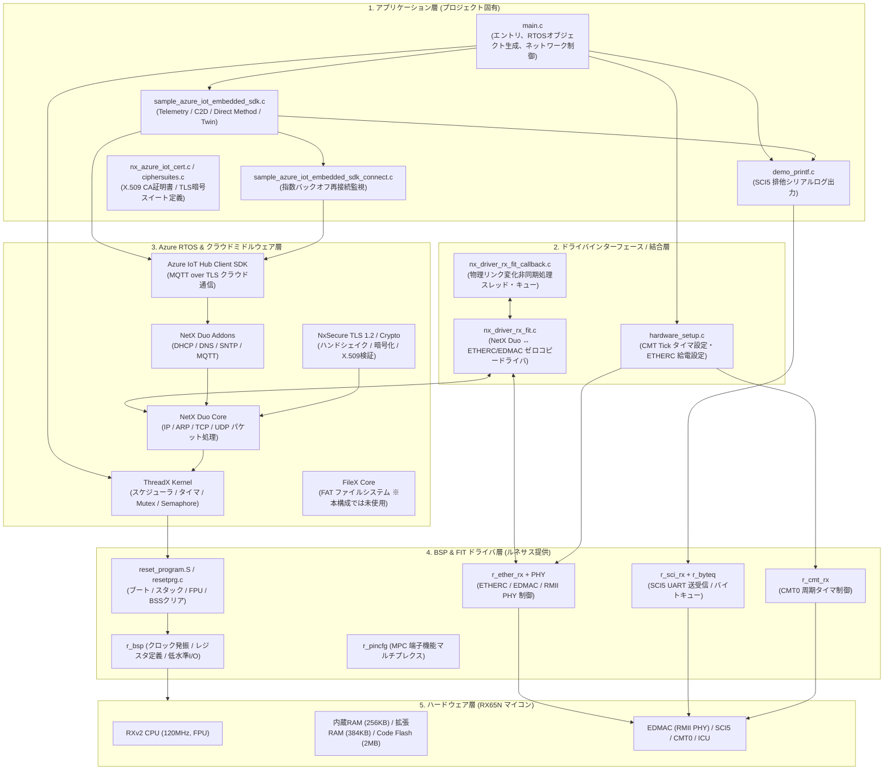
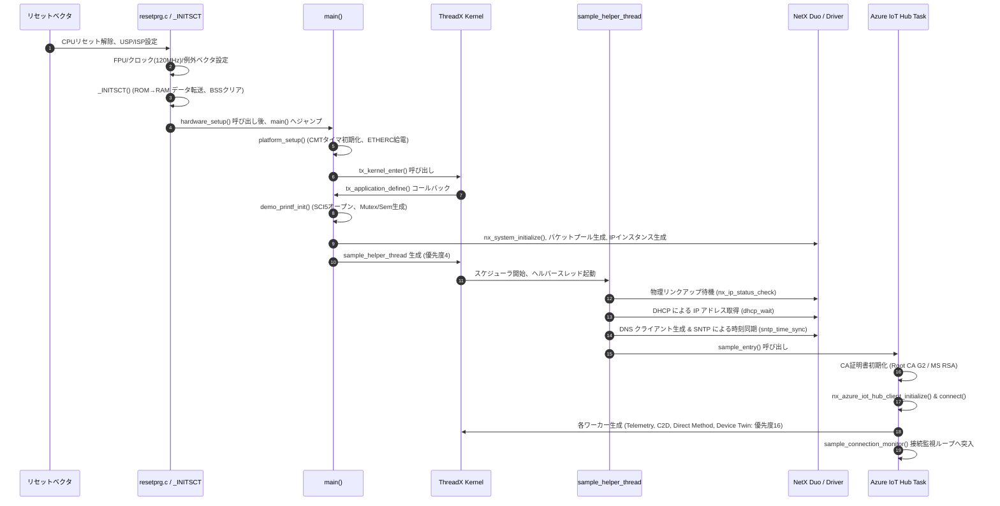

# マイコン向け Azure RTOS / Azure IoT 組み込みソフトウェア 設計調査報告書 (DESIGN_SURVEY_REPORT)

本書は、ルネサス エレクトロニクス製 RX65N マイコン向け Azure RTOS (ThreadX / NetX Duo) および Azure IoT Embedded SDK for C 統合プロジェクトのリポジトリ全体を対象とした設計調査報告書である。

---

# 第1章 リポジトリ全体アーキテクチャ調査結果

## 1.1 システム概要とターゲット環境
- **対象MCU**: Renesas RX65N (型番: R5F565NEDDFP / RX65N-2MB 品等)
  - コアアーキテクチャ: RXv2 (最高 120MHz 動作、単精度FPU内蔵、32ビット命令/レジスタ)
  - 内蔵ROM (Code Flash): 2,097,152 バイト (2 MB, `0xFFE00000` 〜 `0xFFFFFFFF`)
  - 内蔵データフラッシュ: 32,768 バイト (32 KB, `0x00100000` 〜 `0x00107FFF`)
  - 内蔵RAM: 262,144 バイト (256 KB, `0x00000004` 〜 `0x0003FFFF`)
  - 内蔵拡張RAM (RAM2): 393,216 バイト (384 KB, `0x00800000` 〜 `0x0085FFFF`)
  - 内蔵周辺回路: ETHERC (Ethernet コントローラ) / EDMAC (Ethernet DMA), SCI5 (シリアルコミュニケーションインターフェース), CMT0 (コンペアマッチタイマ), MPC (マルチファンクションピンコントローラ), ICU (割り込みコントローラ)
- **RTOS / ネットワーク**: Azure RTOS
  - ThreadX v6.1 (リアルタイムカーネル)
  - NetX Duo v6.1 (IPv4 / TCP / UDP / ARP / ICMP プロトコルスタック)
  - NetX Duo Addons (DHCP Client, DNS Client, SNTP Client, MQTT Client)
  - NxSecure TLS 1.2 (暗号化通信レイヤ) & Crypto Libraries (暗号演算ライブラリ)
  - Azure IoT Embedded C SDK (IoT Hub Client, Device Provisioning Service)
- **開発・ビルド環境**:
  - IDE: e2 studio (Eclipse CDT ベース)
  - コンパイラ: GCC for Renesas RX (GCC_RX `rx-elf-gcc` v14.2)
  - ランタイムライブラリ: Newlib (標準Cライブラリ)
  - コンパイルオプション: `-O2 -ffunction-sections -fdata-sections -fno-strict-aliasing -misa=v2 -mlittle-endian-data -m64bit-doubles -std=gnu99`

---

## 1.2 ソフトウェアレイヤ構造とコンポーネント接続関係

本ソフトウェアは以下の5層構造で構成されている。

---

## 1.3 物理メモリマップおよびリンカセクション配置

GCC リンカスクリプト（`src/linker_script.ld`）およびマップファイル（`HardwareDebug/azure_sdk.map`）の分析に基づくメモリ配置構造：

| 領域名 | 開始アドレス | 終了アドレス | サイズ | 主な配置セクション | 用途・制約 |
| :--- | :---: | :---: | :---: | :--- | :--- |
| **RAM** | `0x00000004` | `0x0003FFFF` | 256 KB | `B_ETHERNET_BUFFERS_1` `B_RX_DESC_1` `B_TX_DESC_1` `.data` `.r_bsp_istack` `.r_bsp_ustack` | 内蔵高速RAM。 **EDMAC用バッファ（0x00010000固定）およびディスクリプタはEDMACのバス仕様により必ずこの領域に配置必須。** 初期値付きデータ（ROMから転送）およびシステムスタック（ISP: 1KB, USP: 4KB）を配置。 |
| **RAM2** | `0x00800000` | `0x0085FFFF` | 384 KB | `.bss` (全体: 約156KB) `_end` | 内蔵拡張RAM。 NetX Duo パケットプール（約50KB）、TLS メタデータバッファ、全スレッドスタック領域（各2KB〜6KB）、SCIバッファ等を配置。 |
| **ROM** | `0xFFE00000` | `0xFFFFFFFF` | 2 MB | `.text` `.rodata` `.rvectors` `.fvectors` | 内蔵コードフラッシュ。 実行プログラム命令、定数データ（CA証明書バイナリ等）、例外/割り込みベクタテーブルを配置。 |
| **OFS** | `0xFE7F5D00` | `0xFE7F5D7F` | 128 B | `.ofs1` 〜 `.ofs8` | オプション設定メモリ（WDT自動開始、リセット設定、保護設定）。 |

---

## 1.4 実行制御フローおよびシーケンス

---

# 第2章 全ファイル・ディレクトリの4分類一覧

リポジトリ内の全ファイルおよびディレクトリについて、makefile、subdir.mk、リンカスクリプト、インクルード依存関係、シンボル参照に基づき以下の4つに分類した。

- **A. 詳細コードレビューが必要**: プロジェクト固有コード、カスタムドライバ層、リンカスクリプト、設定ファイル。
- **B. 基本設計のための調査が必要**: 使用している外部ミドルウェアの公開API、RTOSポート層、スタートアップ、低水準I/O、ルネサスFITドライバ層。
- **C. ビルドされるが、設計上の詳細説明は不要**: makefile によりコンパイル・リンクされるが、設計書上は内部実装・ブラックボックスとして扱える標準OSS内部ソース、または未使用のアドオン機能。
- **D. ビルド対象外、バックアップ、生成物、または未使用**: ビルド対象外（ドキュメント、IDE設定ファイル、trashフォルダ、中間・最終生成物等）。

| ファイル / ディレクトリ パス | 分類 | 役割・機能概要 | ビルド対象 | 参照元 / 呼出元 | 主要API / シンボル | 分類理由 |
| :--- | :---: | :--- | :---: | :--- | :--- | :--- |
| `src/main.c` | **A** | システムエントリ、RTOSオブジェクト生成、ネットワーク確立、DHCP/SNTP制御 | 対象 | `resetprg.c` (`main`), ThreadX | `main`, `tx_application_define`, `sample_helper_thread_entry`, `sntp_time_sync` | アプリケーションの最上位シーケンスであり、起動順序やタスク生成を統括するため。 |
| `src/hardware_setup.c`, `.h` | **A** | ボードハードウェア設定、CMTタイマ初期化、イーサネット給電制御 | 対象 | `main.c` (`platform_setup`), CMT割込 | `platform_setup`, `timer_callback`, `_tx_timer_interrupt` | RTOS Tick起動タイミングとハードウェア初期化の競合が発生する重要箇所のため。 |
| `src/demo_printf.c`, `.h` | **A** | SCI5シリアル出力、排他制御（Mutex/Semaphore）、標準入出力リダイレクト | 対象 | `main.c`, `lowlvl.c`, 全タスク | `demo_printf_init`, `demo_printf`, `my_sw_charput_function`, `demo_printf_transmit_end` | バッファ境界外アクセス、送信エラー時のデッドロック、リアルタイム性阻害が存在するため。 |
| `src/nx_driver_rx_fit.c`, `.h` | **A** | NetX DuoとFITイーサネット（r_ether_rx）の結合ゼロコピードライバ | 対象 | `main.c`, NetX Duo IPスタック | `nx_driver_rx_fit`, `_netx_driver_packet_send`, `_rx_ether_int_cb` | アライメント違反キャスト、ヘッダアンダーラン、ISR共有変数の揮発性不備が存在するため。 |
| `src/nx_driver_rx_fit_callback.c`, `.h` | **A** | リンク変化非同期処理スレッド、ブロックプール、キュー管理 | 対象 | `nx_driver_rx_fit.c` | `_initialize_resources_for_callback_LinkProcess`, `_callback_LinkProcess_entry` | スタック1KBでのprintf呼び出しによる溢れリスク、プールアライメント未保証のため。 |
| `src/sample_azure_iot_embedded_sdk.c` | **A** | Azure IoT Hubクライアント生成、各機能スレッド制御（Telemetry/C2D/Method/Twin） | 対象 | `main.c` (`sample_entry`) | `sample_entry`, `sample_telemetry_thread_entry`, `sample_c2d_thread_entry` 等 | IoT機能の中核であり、再接続時の状態不整合や排他制御欠如の検証が必須のため。 |
| `src/sample_azure_iot_embedded_sdk_connect.c` | **A** | 指数バックオフ（Jitter付き）再接続ループ、ネットワーク監視 | 対象 | `sample_azure_iot_embedded_sdk.c` | `sample_connection_monitor`, `exponential_backoff_with_jitter` | 符号付き整数シフトオーバーフロー（UB）および再接続ステータス未伝播バグがあるため。 |
| `src/sample_config.h` | **A** | IoT Hub接続先、認証方式（SAS/X.509）、DPSパラメータ、スレッド設定 | 対象 | `sample_azure_iot_embedded_sdk.c` 等 | `HOST_NAME`, `DEVICE_ID`, `DEVICE_SYMMETRIC_KEY`, `SAMPLE_STACK_SIZE` | システム全体の動作モード・通信先・認証設定を決定づける定義ファイルのため。 |
| `src/sample_device_identity.c` | **A** | X.509 デバイス証明書および秘密鍵データ配列定義 | 対象 | `sample_azure_iot_embedded_sdk.c` | `sample_device_cert_ptr`, `sample_device_private_key_ptr` | セキュリティ認証の鍵情報であり、メモリ配置・形式妥当性の確認が必要なため。 |
| `src/nx_azure_iot_cert.c`, `.h` | **A** | Azure IoT ルートCA証明書バイナリ配列（Baltimore, Global Root G2, MS RSA） | 対象 | `sample_azure_iot_embedded_sdk.c` | `_nx_azure_iot_root_cert`, `_nx_azure_iot_root_cert_2`, `_nx_azure_iot_root_cert_3` | Baltimore Root の有効期限切れ（2025年5月満了）による接続障害を検証するため。 |
| `src/nx_azure_iot_ciphersuites.c`, `.h` | **A** | サポートするTLS 1.2 / X.509 暗号スイートテーブル定義 | 対象 | `sample_azure_iot_embedded_sdk.c` | `_nx_azure_iot_tls_supported_crypto`, `_nx_azure_iot_tls_ciphersuite_map` | 暗号アルゴリズム（AES, SHA256, RSA）の適合性・設定不整合を検証するため。 |
| `src/linker_script.ld` | **A** | GCC用メモリマップ定義（RAM, RAM2, ROM, OFS）およびセクション配置 | 対象 | リンカ (`rx-elf-gcc`) | `_bss`, `_ebss`, `_end`, `_istack`, `_ustack`, `_B_ETHERNET_BUFFERS_1_start` | `.bss` が RAM2 に置かれ、EDMACバッファとスタックが RAM に置かれる設計の妥当性検証のため。 |
| `src/smc_gen/r_config/r_bsp_config.h`, `r_bsp_interrupt_config.h` | **A** | BSP構成設定（クロック周波数、ヒープサイズ、スタックサイズ、拡張RAM、RTOS） | 対象 | `r_bsp` 全体 | `BSP_CFG_USTACK_BYTES`, `BSP_CFG_ISTACK_BYTES`, `BSP_CFG_HEAP_BYTES`, `BSP_CFG_RTOS_USED` | ヒープ1KB制限、IWDT無効、拡張RAM無効設定などシステム停止リスクを検証するため。 |
| `src/smc_gen/r_config/r_ether_rx_config.h` | **A** | イーサネットFIT設定（PHYアドレス、送受信記述子数、バッファサイズ、RMIIモード） | 対象 | `r_ether_rx.c`, `nx_driver_rx_fit.c` | `ETHER_CFG_MODE_SEL`, `ETHER_CFG_CH0_PHY_ADDRESS`, `ETHER_CFG_EMAC_RX_DESCRIPTORS` | ハードウェア接続仕様（PHYアドレス=5）およびバッファ数の通信性能への影響検証のため。 |
| `src/smc_gen/r_config/r_sci_rx_config.h` | **A** | SCI FIT設定（チャネル別キューサイズ、優先度、DTC/DMAC利用設定） | 対象 | `r_sci_rx.c`, `demo_printf.c` | `SCI_CFG_CH5_INCLUDED`, `SCI_CFG_CH5_TX_BUFSIZ` | SCI5の送信バッファや割り込みレベルの適合性を検証するため。 |
| `src/smc_gen/r_config/r_cmt_rx_config.h` | **A** | CMT FIT設定（タイマ割り込み優先度レベル） | 対象 | `r_cmt_rx.c`, `hardware_setup.c` | `CMT_CFG_CH0_INT_PRIORITY` | RTOS Tick割り込み優先度の妥当性を検証するため。 |
| `src/smc_gen/r_config/r_byteq_config.h` | **A** | バイトキュー設定（最大キュー数、パラメータチェック） | 対象 | `r_byteq.c` | `BYTEQ_CFG_PARAM_CHECKING_ENABLE`, `BYTEQ_CFG_MAX_QUEUES` | SCIドライバ内部のキュー資源枯渇リスクを検証するため。 |
| `libs/threadx/tx_user.h` | **A** | ThreadX カーネル静的コンフィグ（Tickレート、タイマ優先度、スタックチェック等） | 対象 | ThreadX 全体 | `TX_TIMER_TICKS_PER_SECOND`, `TX_DISABLE_NOTIFY_CALLBACKS`, `TX_LOW_POWER` | RTOSの基本挙動（Tick=100Hz、コールバック無効化、省電力無効）を決定づけるため。 |
| `libs/netxduo/nx_user.h` | **A** | NetX Duo ネットワーク静的コンフィグ（パケットサイズ、オフロード、タイムアウト等） | 対象 | NetX Duo 全体 | `NX_PHYSICAL_HEADER`, `NX_DISABLE_ERROR_CHECKING`, `NX_DNS_CLIENT_USER_CREATE_PACKET_POOL` | ネットワークのヘッダマージンやセキュリティ機能の有効化状態を検証するため。 |
| `libs/filex/fx_user.h` | **A** | FileX 静的コンフィグ（セクタキャッシュ、パス長、エラーチェック） | 対象 | FileX 全体 | `FX_MAX_LONG_NAME_LEN`, `FX_DISABLE_ERROR_CHECKING` | ビルドに含まれる FileX の構成パラメータの整合性確認のため。 |
| `libs/threadx/ports/rxv2/gnu/src/` | **B** | ThreadX RXv2 GNU ポート層（初期化アセンブリ、コンテキスト保存・復帰、スケジューラ） | 対象 | ThreadX, CPU例外 | `__tx_initialize_low_level`, `_tx_timer_interrupt`, `_tx_thread_schedule` | CPUレジスタ（PSW, USP, ISP, ACC）退避復帰および Tick/SWINT ハンドラ仕様把握のため。 |
| `libs/threadx/common/inc/` | **B** | ThreadX 公開ヘッダ（API定義、オブジェクト構造体） | 対象 | システム全体 | `tx_thread_create`, `tx_mutex_get`, `tx_semaphore_get`, `tx_time_get` | RTOSの全サービス呼び出し・同期機構の基本設計仕様把握のため。 |
| `libs/netxduo/common/inc/` | **B** | NetX Duo 公開ヘッダ（IP, パケットプール, TCP, UDP, ARP, ICMP インターフェース） | 対象 | システム全体 | `nx_system_initialize`, `nx_packet_pool_create`, `nx_ip_create`, `nx_packet_allocate` | ネットワークスタックの基本構造・パケットフロー把握のため。 |
| `libs/netxduo_addons/nx_secure/inc/` | **B** | NxSecure TLS 1.2 公開ヘッダ（セッション作成、X.509検証） | 対象 | `main.c`, `sample_azure_iot_embedded_sdk.c` | `nx_secure_tls_initialize`, `nx_secure_x509_certificate_initialize` | 暗号化通信セッション確立シーケンスの設計把握のため。 |
| `libs/netxduo_addons/addons/dhcp/`, `dns/`, `sntp/` | **B** | アプリケーションが使用する NetX Duo アドオン公開インターフェース | 対象 | `main.c` | `nx_dhcp_create`, `nx_dns_create`, `nx_sntp_client_create` | IP自動取得、ドメイン解決、SNTP時刻同期の制御方式把握のため。 |
| `libs/netxduo_addons/addons/azure_iot/` (公開部) | **B** | Azure IoT Hub / Provisioning Client 公開ヘッダ | 対象 | `sample_azure_iot_embedded_sdk.c` | `nx_azure_iot_hub_client_initialize`, `nx_azure_iot_hub_client_telemetry_send` | クラウド連携API仕様、引数、リターンコード、コールバックの設計把握のため。 |
| `src/smc_gen/r_bsp/mcu/all/reset_program.S`, `resetprg.c` | **B** | RX65N リセットスタートアップ、Cランタイム初期化、ハードウェア初期化 | 対象 | リセット例外ベクタ | `_PowerON_Reset`, `_PowerON_Reset_PC_Prg`, `_INITSCT` | ブートシーケンス、スタックポインタ設定、BSSゼロクリアの実行順序把握のため。 |
| `src/smc_gen/r_bsp/mcu/all/sbrk.c`, `lowsrc.c`, `lowlvl.c` | **B** | Newlib 向け低水準入出力スタブ（ヒープ割当 `sbrk`、`write`、`charput`） | 対象 | Newlib libc (`printf`, `malloc`) | `sbrk`, `write`, `read`, `charput` | 標準ライブラリとハードウェア/シリアルドライバ間の接続仕様把握のため。 |
| `src/smc_gen/r_bsp/mcu/rx65n/` (コア部) | **B** | RX65N クロック発振、割り込みコントローラ初期化、固定ベクタテーブル、レジスタ定義 | 対象 | `r_bsp`, CPU割り込み | `mcu_clock_setup`, `bsp_interrupt_open`, `g_bsp_Locks`, `iodefine.h` | ハードウェアの周波数仕様（120MHz動作）や周辺レジスタ構造把握のため。 |
| `src/smc_gen/r_bsp/board/generic_rx65n/hwsetup.c` | **B** | ボード固有ハードウェア初期化（`hardware_setup` 関数） | 対象 | `resetprg.c` | `hardware_setup` | MCUピン初期化やSmart Configurator生成ハードウェア設定の呼出元把握のため。 |
| `src/smc_gen/general/` | **B** | Smart Configurator 共通初期化（クロック・割り込み・端子一括設定） | 対象 | `hwsetup.c` | `R_Systeminit`, `r_cgc_create`, `r_smc_interrupt_initialize` | 生成された初期化関数の呼び出し順序・クロック供給設計把握のため。 |
| `src/smc_gen/r_cmt_rx/` | **B** | コンペアマッチタイマ FIT ドライバ公開API・実装（RTOS Tick生成） | 対象 | `hardware_setup.c` | `R_CMT_CreatePeriodic`, `R_CMT_Stop` | RTOS Tick（10ms周期）の生成ハードウェア制御把握のため。 |
| `src/smc_gen/r_ether_rx/` | **B** | イーサネット（ETHERC / EDMAC）および外部 PHY LSI 制御ドライバ | 対象 | `nx_driver_rx_fit.c`, `hardware_setup.c` | `R_ETHER_Initial`, `R_ETHER_Open_ZC2`, `R_ETHER_Read_ZC2`, `R_ETHER_Write_ZC2_GetBuf` | ゼロコピー通信、RMII制御、送受信割り込みとリンク検出機構の設計把握のため。 |
| `src/smc_gen/r_sci_rx/` | **B** | シリアル通信（SCI5）FIT ドライバ（調歩同期式 UART） | 対象 | `demo_printf.c` | `R_SCI_Open`, `R_SCI_Send`, `R_SCI_Control` | デバッグ通信ポートのボーレート（115200bps）および割り込み制御把握のため。 |
| `src/smc_gen/r_byteq/` | **B** | バイトキュー FIT ドライバ（SCI の送受信バッファ管理） | 対象 | `r_sci_rx.c` | `R_BYTEQ_Open`, `R_BYTEQ_Put`, `R_BYTEQ_Get` | SCI ドライバ内部のリングバッファ構造と排他仕様把握のため。 |
| `src/smc_gen/r_pincfg/` | **B** | MPC（マルチファンクションピンコントローラ）端子設定 | 対象 | `hardware_setup.c`, `demo_printf.c` | `R_ETHER_PinSet_ETHERC0_RMII`, `R_SCI_PinSet_SCI5` | マイコン端子の物理ピン配置（ET0_RMII, RXD5/TXD5）の設計把握のため。 |
| `src/rtos_config/azurertos_object_init.c`, `.h` | **B** | Smart Configurator 生成の Azure RTOS オブジェクト初期化雛形 | 対象 | 未呼出（空実装） | `tx_application_define_user` | 自動生成コードとアプリケーションコードの統合ポイント確認のため。 |
| `libs/threadx/common/src/` | **C** | ThreadX カーネルコア内部実装（`tx_thread_*.c`, `tx_mutex_*.c` 等） | 対象 | ThreadX API | `_tx_thread_system_return`, `_tx_initialize_kernel_enter` 等 | 標準OSS内部コードであり、公開APIおよびポート層の把握で十分なため。 |
| `libs/netxduo/common/src/` | **C** | NetX Duo プロトコルスタックコア内部実装（`nx_ip_*.c`, `nx_tcp_*.c` 等） | 対象 | NetX Duo API | `_nx_ip_packet_receive`, `_nx_tcp_socket_send` 等 | 標準OSS内部コードであり、パケットフローおよび公開APIの把握で十分なため。 |
| `libs/netxduo_addons/nx_secure/src/` | **C** | TLS 1.2 ハンドシェイク・レコード層プロトコル内部実装 | 対象 | NxSecure API | `_nx_secure_tls_handshake_process` 等 | 標準TLSスタック内部ルーチンであり、ブラックボックスとして扱えるため。 |
| `libs/netxduo_addons/crypto_libraries/src/` | **C** | 暗号アルゴリズム内部演算実装（AES, SHA1, SHA256, RSA, ECC, HMAC） | 対象 | NxSecure, Azure IoT | `_nx_crypto_sha256_process`, `_nx_crypto_aes_encrypt` 等 | 標準暗号アルゴリズムの定型計算処理であり、詳細設計説明が不要なため。 |
| `libs/netxduo_addons/addons/mqtt/` (内部実装) | **C** | MQTT クライアントコア内部実装 | 対象 | Azure IoT Hub Client | `_nxd_mqtt_client_packet_process` 等 | Azure IoT SDK 内部でラップされて使用される下位プロトコルのため。 |
| `libs/netxduo_addons/addons/azure_iot/azure-sdk-for-c/` | **C** | Azure SDK for C コア実装（JSONパーサー、HTTP/MQTTエンコーダ） | 対象 | Azure IoT Hub Client | `az_iot_hub_client_telemetry_get_publish_topic` 等 | Microsoft 公式 C SDK の内部ユーティリティであり、直接変更・説明不要なため。 |
| `libs/netxduo_addons/addons/azure_iot/azure_iot_security_module/` | **C** | IoT セキュリティモジュール、FlatCC ランタイム、シリアライザ | 対象 | Azure IoT Addon | `flatcc_builder_init` 等 | 定型シリアライザ内部処理であり、設計書上はサブモジュール表記で十分なため。 |
| `libs/filex/common/src/` | **C** | FileX FAT12/16/32 ファイルシステムコア実装 | 対象 | 未呼出（リンクのみ） | `fx_system_initialize`, `fx_media_open` 等 | makefile 上ビルドされるが、本アプリケーションでは未使用のため。 |
| `libs/netxduo_addons/addons/web/`, `snmp/`, `smtp/`, `nat/`, `http/`, `cloud/` | **C** | 未使用の NetX Duo ネットワークアドオンモジュール群 | 対象 | 未呼出（リンクのみ） | `nx_web_http_server_create` 等 | makefile 上コンパイルされるが、本アプリケーションでは未使用のため。 |
| `libs/threadx/utility/low_power/` | **C** | ThreadX ティックレス低電力ユーティリティ | 対象 | 未呼出（マクロ無効） | `_tx_low_power_enter` | `tx_user.h` で `TX_LOW_POWER 0` と無効化されており、機能しないため。 |
| `src/smc_gen/r_sci_rx/src/r_sci_rx_dmaca.c`, `r_sci_rx_dtc.c` | **C** | SCI 用 DMA / DTC 転送スタブコード | 対象 | `r_sci_rx.c` | `r_sci_dma_tx_enable` | 本システムでは割り込み転送モードを使用しており、DMA/DTCは未使用のため。 |
| `src/smc_gen/r_bsp/mcu/all/dbsct.c` | **C** | CCRX コンパイラ用セクション配置テーブル | 対象 | 未使用 (GCC使用) | `_DTBL`, `_BTBL` | GCC for RX ツールチェーンでは使用されないコンパイラ互換スタブのため。 |
| `src/smc_gen/r_bsp/mcu/all/r_bsp_software_interrupt.c`, `r_bsp_locking.c`, `mcu_locks.c`, `r_bsp_mcu_startup.c`, `r_rx_intrinsic_functions.c` | **C** | BSP 内部サポート関数（内蔵ロック変数、組み込み関数スタブ） | 対象 | `r_bsp` 内部 | `R_BSP_SoftwareInterrupt`, `R_BSP_HardwareLock` | BSP内部の補助関数群であり、基本設計書上は概要記載で十分なため。 |
| `src/smc_gen/r_bsp/mcu/rx65n/mcu_mapped_interrupts.c` | **C** | マップド割り込みサポートルーチン | 対象 | `r_bsp` 内部 | `r_bsp_mapped_interrupt` | 固定割り込み構成のため本システムでは直接依存しない補助関数のため。 |
| `trash/` 配下の全ファイル | **D** | 過去の変更バックアップ・作業一時ファイル群 | 非対象 | なし | なし | バックアップ用のゴミ箱ディレクトリであり、ビルドおよび設計から完全に対象外。 |
| `HardwareDebug/` 配下の生成物 (`*.o`, `*.d`, `*.lst`, `*.elf`, `*.map`, `*.siz`) | **D** | ビルド成果物、中間オブジェクト、依存関係ファイル、マップファイル | 非対象 | コンパイラ出力 | なし | ソースコードではなく、コンパイル・リンクによって自動生成される成果物のため。 |
| `HardwareDebug/makefile`, `sources.mk`, `objects.mk`, 各 `subdir.mk` | **D** | e2 studio / Eclipse CDT 自動生成 makefile 群 | 対象外 (ビルド実行側) | make ツール | `all`, `clean` | IDE が自動生成・管理するビルドスクリプトであり、設計対象ソースではないため。 |
| `.settings/`, `.project`, `.cproject`, `.clangd`, `*.launch` | **D** | Eclipse CDT / e2 studio / エディタ プロジェクト環境設定 | 非対象 | IDE / Toolchain | なし | 開発環境の管理メタデータファイルのため。 |
| `azure_sdk.scfg` | **D** | Renesas Smart Configurator 設計定義 XML ファイル | 非対象 | Smart Configurator | なし | C言語コードではなく、コード生成元ツール用のGUI設定ファイルのため。 |
| `README.md`, `SECURITY.md`, `LICENSE.txt`, `LICENSED-HARDWARE.txt` | **D** | ドキュメント、ライセンス条項、既知の問題説明 | 非対象 | なし | なし | ソースコードではないため。 |
| `r01an6455ej0103-rx-azure-rtos.pdf`, 各種ドライバ doc PDF | **D** | ルネサス公式アプリケーションノート、FITモジュール仕様書 PDF | 非対象 | なし | なし | 参照ドキュメント（バイナリ）のため。 |

---

# 第3章 分類A ファイルにおけるコードレビュー観点・潜在リスク詳細

詳細コードレビューの対象である「分類A」の各ファイルについて、発見された潜在リスク、設計上の欠陥、およびレビュー観点を整理する。

### 3.1 `demo_printf.c`: バッファオーバーランおよびデッドロック
1. **`vsnprintf` の戻り値処理誤り（バッファ外アクセス）**:
   - 63行目の `len = (size_t)vsnprintf(&demo_printf_buf[0], sizeof(demo_printf_buf), format, v_args);` において、書き込み文字数がバッファサイズを超過した際、`len >= sizeof(demo_printf_buf)` となる。直後の `R_SCI_Send(Console, (uint8_t *)demo_printf_buf, len);` でバッファ境界外のメモリを読み出して送信してしまう（未定義動作・情報漏洩）。
2. **`R_SCI_Send` エラー時の永久デッドロック**:
   - `R_SCI_Send` の戻り値を検査せず、無条件で `tx_semaphore_get(&demo_printf_semaphore, TX_WAIT_FOREVER)` を呼んでいる。もし送信開始に失敗（ビジーや引数不正等）した場合、送信完了割り込み（TEI）は発生しないため、呼び出しスレッドが永久ブロックする。
3. **1文字ごとのコンテキストスイッチによるリアルタイム性阻害**:
   - `my_sw_charput_function`（Newlib `printf` の1文字出力先）で文字ごとに Mutex 取得 $\to$ SCI 送信 $\to$ セマフォ待ち（サスペンド） $\to$ 割り込み $\to$ 起床を繰り返すため、大量ログ出力時にシステムが著しく低速化し、他タスクのリアルタイム性を破壊する。

### 3.2 `nx_driver_rx_fit.c`: アライメント違反・バッファアンダーラン・volatile欠如
1. **アライメント違反キャストおよびバッファ先頭破壊（アンダーラン）**:
   - 524行目 `frame_ptr = (ULONG *) (packet_ptr->nx_packet_prepend_ptr - 2);`
   - Ethernet ヘッダ（14バイト）を 4 バイト単位で 4 回（16バイト）書き込むため、先頭を `- 2` バイトオフセットしてアクセスしている。パケットバッファの先頭余白が 2 バイト未満の場合、`NX_PACKET` 構造体自身のヘッダメンバを上書き破壊する。また、2バイト整列アドレスに対する 32 ビットアクセスは C99 規格上の未定義動作（Alignment Violation）である。
2. **ISR 共有変数の `volatile` 修飾欠如**:
   - `netx_driver_rx_fit_data[chan].deferred_events_flags` が `ULONG` で宣言されており、`volatile` が付与されていない。割り込みハンドラ `_rx_ether_int_cb` でセットされたフラグがコンパイラ最適化（`-O2`）でレジスタキャッシュされ、タスク側の遅延処理ループで検知できないリスクがある。

### 3.3 `nx_driver_rx_fit_callback.c`: スタックオーバーフローおよびアライメント未保証
1. **スタック 1KB での `printf` 呼び出し**:
   - `callback_LinkProcess_thread` のスタックが 1024 バイトしかない。Newlib の `printf()` はスタックを数百バイト以上消費するため、リンクアップ/ダウン時にスタックオーバーフローを引き起こす。
2. **ブロックプールバッファのアライメント不正**:
   - `UCHAR callback_LinkProcess_memory_area[...]` が 1 バイト整列型で定義されており、`tx_block_pool_create` が要求する 4 バイトアライメントを満たさない可能性がある。

### 3.4 `sample_azure_iot_embedded_sdk_connect.c`: 符号付き整数シフトオーバーフロー（UB）
1. **指数バックオフ計算における 32bit 符号付きオーバーフロー**:
   - 43行目 `(1 << exponential_retry_count)` において、`exponential_retry_count` が 31 以上になると符号付き整数オーバーフロー（未定義動作）が発生し、待機時間が負数または 0 になり、再試行ストーム（DoS状態）に陥る。

### 3.5 `sample_azure_iot_embedded_sdk.c`: 再接続時の状態不整合および排他欠如
1. **再接続成功時のグローバル状態更新漏れ**:
   - `sample_connection_monitor` の第3引数 `connection_status` が値渡しのため、再接続に成功してもグローバル変数 `sample_connection_status` が `NX_SUCCESS` に更新されず、Telemetry / Twin 等の全ワーカータスクが永久スリープする。
2. **`iothub_client` の排他制御欠如**:
   - 切断・再初期化処理中に他スレッドがクライアント API を呼び出す可能性があり、競合によりクラッシュする。

### 3.6 `nx_azure_iot_cert.c`: DigiCert Baltimore Root 証明書の有効期限切れ
1. **2025年5月12日での証明書満了**:
   - `_nx_azure_iot_root_cert`（Baltimore Root）の有効期間が `250512235900Z`（2025-05-12）で終了している。現在時刻（2026年）では TLS 検証エラー（`NX_SECURE_TLS_CERTIFICATE_EXPIRED`）で接続不能となる。最新の `DigiCert Global Root G2` のみを使用する構成へ修正が必須。

### 3.7 `linker_script.ld` & `r_bsp_config.h`: RAM2 配置と拡張RAM初期化の不整合
1. **拡張RAM初期化前のアクセスリスク**:
   - リンカスクリプトで `.bss` 全体が `RAM2`（拡張RAM: `0x00800000`）に配置されている一方、`r_bsp_config.h` では `BSP_CFG_EXPANSION_RAM_ENABLE` が `0`（無効）になっている。リセット直後のスタートアップで拡張RAMがアクセス可能か、ハードウェアマニュアルとの整合確認が必須。
