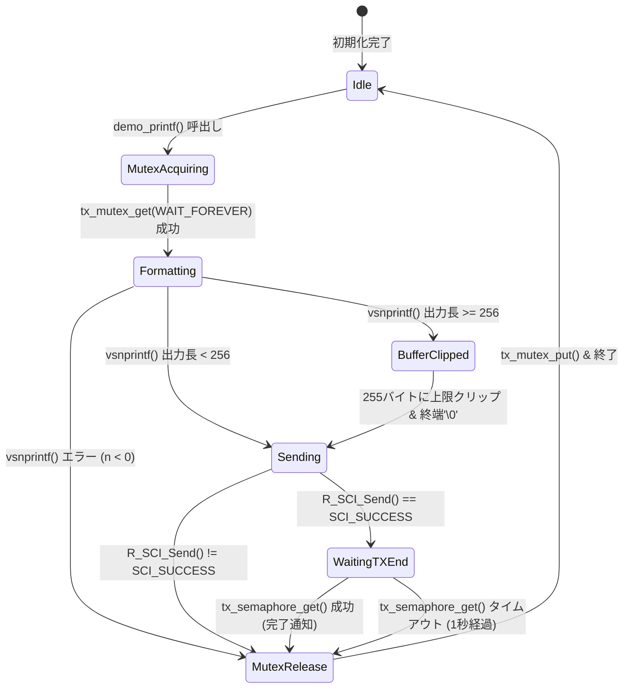
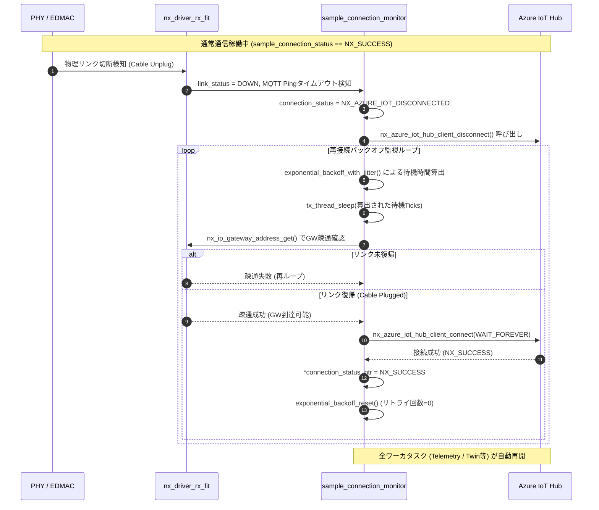
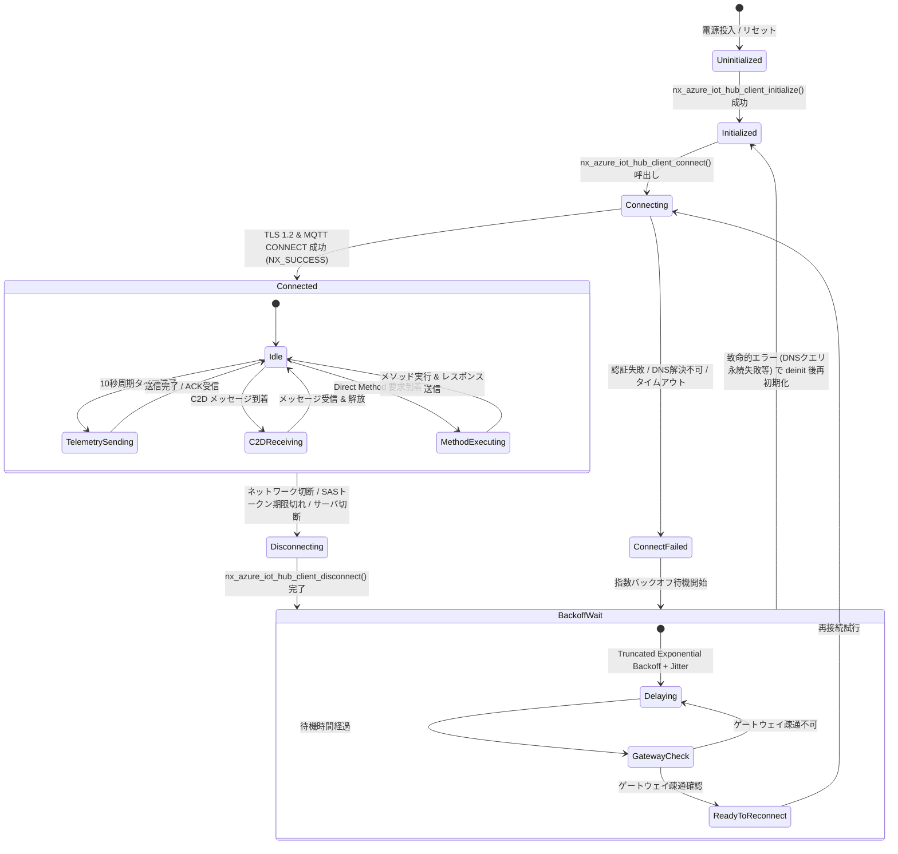

# 詳細設計書 (DETAILED DESIGN SPECIFICATION)
## Renesas RX65N Cloud Kit - Azure RTOS & Azure IoT Hub 組み込みシステム

---

## 1. システム概要と詳細設計方針

### 1.1 本書の目的とスコープ
本書は、[基本設計書 (BASIC_DESIGN_SPECIFICATION.md)](BASIC_DESIGN_SPECIFICATION.md) にて定義されたアーキテクチャおよび機能仕様に基づき、各ソフトウェアモジュールの内部実装、データ構造、制御アルゴリズム、タスク同期、状態遷移の詳細を定義する詳細設計書である。
特に、実機運用においてシステムの安定性・リアルタイム性・安全性を左右する以下の重要モジュールを対象とし、コードレベルの実装根拠と整合性を明記する。

1. **`demo_printf`**: 排他制御付き SCI UART シリアルコンソール出力
2. **`nx_driver_rx_fit`**: EDMAC ゼロコピー（ZC2）対応 Ethernet ネットワークドライバ
3. **`sample_azure_iot_embedded_sdk_connect`**: 指数バックオフ（Full Jitter）再接続・ネットワーク監視制御
4. **`sample_azure_iot_embedded_sdk`**: Azure IoT Hub クライアントタスク（Telemetry, C2D, Direct Method, Device Twin）

---

## 2. モジュール詳細設計

### 2.1 `demo_printf` (コンソール出力モジュール)

#### 2.1.1 機能概要
UART（SCI5、115,200 bps）を経由してマルチスレッドセーフな文字列フォーマット出力機能を提供する。複数スレッドおよび割込みコンテキストからの同時呼び出しに対して、ThreadX Mutex による排他制御と、送信完了割り込みによるセマフォ同期を行う。

#### 2.1.2 バッファクリップ機構とオーバーラン防止
- **内部静的バッファ**: `char demo_printf_buf[256]`
- **境界保護アルゴリズム**:
  1. `vsnprintf` を呼び出してフォーマット展開を実施。
  2. 戻り値 `n` が負値（エンコードエラー等）の場合は即座に Mutex を解放してリターン。
  3. `n >= sizeof(demo_printf_buf)` の場合（出力文字列が 256 バイト以上）、`len = sizeof(demo_printf_buf) - 1u`（255 バイト）へクリップし、終端ヌル文字 `demo_printf_buf[len] = '\0'` を強制書き込み。
  4. クリップされた長さ `(uint16_t)len` のみを `R_SCI_Send` の引数に渡す。

#### 2.1.3 送信処理・デッドロック回避・タイムアウト設計
- **SCI エラー時のフェイルセーフ**:
  `R_SCI_Send()` の戻り値 `sci_err_t err` を判定。`err != SCI_SUCCESS`（送信バッファビジー、パラメータエラー等）の場合は、セマフォ待機をスキップし、直ちに Mutex を解放する。
- **送信完了同期タイムアウト**:
  SCI 送信完了割り込み（`demo_printf_transmit_end`）で `tx_semaphore_put(&demo_printf_semaphore)` が発行されるが、通信線断線やハードウェア異常時の永久デッドロックを防止するため、`tx_semaphore_get` には無期限待機（`TX_WAIT_FOREVER`）ではなく **1秒タイムアウト**（`TX_TIMER_TICKS_PER_SECOND` = 100 ticks）を設定。

#### 2.1.4 状態遷移図


---

### 2.2 `nx_driver_rx_fit` (Ethernet / EDMAC ネットワークドライバ)

#### 2.2.1 ハードウェア構成と EDMAC ZC2 モード
- **対象コントローラ**: Renesas RX65N EDMAC（Ethernet DMA Controller）＋ ETHERC（MAC）
- **PHY 接続**: MII / RMII インターフェース（DP83821 / KSZ8081）
- **ZC2（Zero-Copy 2）制御方式**: NetX Duo のパケットバッファ（`NX_PACKET`）と EDMAC 記述子（Descriptor）の間で、CPU によるペイロードコピーを行わず、DMA 記述子のバッファポインタを直接スワップして送受信を完了する。

#### 2.2.2 送信ヘッダ構築処理（アライメント整合設計）
Ethernet ヘッダ（14バイト）を NetX Duo パケット先頭に付加する際、2バイト整列位置への32bitアクセスによる境界例外およびアンダーランを排除する。

1. **安全なヘッダバッファ**: ローカル配列 `UCHAR eth_header[NX_DRIVER_ETHERNET_FRAME_SIZE]`（14バイト）を確保。
2. **MAC アドレス格納**:
   - 宛先 MAC（6バイト）: `nx_ip_driver_physical_address_msw` および `lsw` からビッグエンディアン形式で `eth_header[0..5]` にバイト単位で代入。
   - 送信元 MAC（6バイト）: インターフェースの物理アドレスから `eth_header[6..11]` に代入。
3. **EtherType 判定**:
   - ARP 送信: `0x0806` (`NX_DRIVER_ETHERNET_ARP`)
   - IPv4 送信: `0x0800` (`NX_DRIVER_ETHERNET_IP`)
   - IPv6 送信: `0x86DD` (`NX_DRIVER_ETHERNET_IPV6`)
   - `eth_header[12] = (UCHAR)(eth_type >> 8); eth_header[13] = (UCHAR)(eth_type);`
4. **安全なコピー**: `memcpy(packet_ptr->nx_packet_prepend_ptr, eth_header, 14);` によりアライメント違反を完全に排除してパケットバッファへ反映。

#### 2.2.3 割り込みイベントフラグと遅延処理同期
- **イベントフラグ変数**: `volatile ULONG deferred_events_flags;`
- **ビット定義**:
  - `0x00000001`: 受信パケット到着イベント（`RX_EVENT`）
  - `0x00000002`: 送信完了イベント（`TX_EVENT`）
  - `0x00000004`: リンク状態変更イベント（`LINK_EVENT`）
- **同期メカニズム**:
  1. EDMAC 割込みハンドラ（ISR）内で該当ビットを OR セットし、ドライバ遅延処理タスクへ ThreadX イベントフラグまたはセマフォで通知。
  2. ドライバタスクは `deferred_events_flags` を読み出し、アトミックにクリアして対応する処理（`_netx_driver_packet_receive` 等）を実行。
  3. `volatile` 修飾により、コンパイラ最適化（レジスタキャッシング）によるフラグ読み飛ばし・デッドロックを防止。

---

### 2.3 `sample_azure_iot_embedded_sdk_connect` (再接続・指数バックオフ)

#### 2.3.1 指数バックオフ（Full Jitter）計算仕様
クラウドサービス（Azure IoT Hub）への接続障害時に、多数の IoT デバイスが一斉に再接続を試みてサーバ負荷を増大させる「サンダーリング・ハード（Thundering Herd）問題」を防止するため、指数バックオフに Jitter（ランダム揺らぎ）を加えた待機時間を算出する。

- **パラメータ仕様**:
  - 初期待機秒数 $T_{\text{init}} = 3$ 秒 (`SAMPLE_INITIAL_EXPONENTIAL_BACKOFF_IN_SEC`)
  - 最大待機秒数 $T_{\text{max}} = 600$ 秒 (`SAMPLE_MAX_EXPONENTIAL_BACKOFF_IN_SEC` = 10分)
  - 最大 Jitter 率 $J_{\text{max}} = 60\%$ (`SAMPLE_MAX_EXPONENTIAL_BACKOFF_JITTER_PERCENT`)
  - リトライ上限クリップ値 $N_{\text{max}} = 8$ 回（$3 \times 2^8 = 768$ 秒 $\ge T_{\text{max}}$）

#### 2.3.2 整数オーバーフロー防止と計算式
```c
static UINT exponential_backoff_with_jitter()
{
    double jitter_percent = (SAMPLE_MAX_EXPONENTIAL_BACKOFF_JITTER_PERCENT / 100.0) * (rand() / ((double)RAND_MAX));
    UINT base_delay = SAMPLE_MAX_EXPONENTIAL_BACKOFF_IN_SEC;
    uint64_t delay;

    /* 32bit符号付き整数シフトオーバーフロー(UB)を防止するため上限を8にクリップ */
    if (exponential_retry_count > 8)
    {
        exponential_retry_count = 8;
    }

    /* 64bit符号なし整数シフトによる安全な指数計算 */
    delay = (uint64_t)((1ULL << exponential_retry_count) * SAMPLE_INITIAL_EXPONENTIAL_BACKOFF_IN_SEC);
    if (delay <= (UINT)(-1))
    {
        base_delay = (UINT)delay;
    }

    if (base_delay > SAMPLE_MAX_EXPONENTIAL_BACKOFF_IN_SEC)
    {
        base_delay = SAMPLE_MAX_EXPONENTIAL_BACKOFF_IN_SEC;
    }
    else
    {
        exponential_retry_count++;
    }

    return ((UINT)(base_delay * (1.0 + jitter_percent)) * NX_IP_PERIODIC_RATE);
}
```

#### 2.3.3 再接続監視ループと状態伝播
`sample_connection_monitor` は値渡しではなくポインタ引数 `UINT *connection_status_ptr` を受領する。
1. `*connection_status_ptr == NX_SUCCESS` の場合:
   - 正常稼働中とみなし、`exponential_backoff_reset()` を実行してリトライカウントを 0 にリセット。
2. `*connection_status_ptr != NX_SUCCESS` の場合:
   - 一旦 `nx_azure_iot_hub_client_disconnect` を呼び出してセッション破棄。
   - 再接続ループへ突入。DNS 解決失敗や認証エラー時はクライアントを `deinitialize` $\to$ `iothub_init` で完全再初期化。
   - バックオフスリープ後、ゲートウェイ通信確認を経て `nx_azure_iot_hub_client_connect` を実行。
   - 接続成功時（`NX_SUCCESS`）に **`*connection_status_ptr = NX_SUCCESS;`** を明示的に書き込んで復帰。

---

### 2.4 `sample_azure_iot_embedded_sdk` (Azure IoT Hub アプリケーション)

#### 2.4.1 スレッド構成一覧
| スレッド名 | エントリ関数 | 優先度 | スタックサイズ | 主な役割 |
|:---|:---|:---:|:---:|:---|
| **IoT Main Thread** | `sample_entry` | 16 | 4,096 B | CA初期化、IoT Hub接続開始、1秒周期監視ループ |
| **Telemetry Thread** | `sample_telemetry_thread_entry` | 16 | 2,048 B | 10秒周期の温度・状態JSONテレメトリ送信 |
| **C2D Thread** | `sample_c2d_thread_entry` | 16 | 2,048 B | クラウドからのメッセージ受信・表示・解放 |
| **Direct Method Thread** | `sample_direct_method_thread_entry` | 16 | 2,048 B | ダイレクトメソッド受信・ハンドラ実行・応答返却 |
| **Device Twin Thread** | `sample_device_twin_thread_entry` | 16 | 2,048 B | Desired プロパティ受信・Reported 状態更新 |

#### 2.4.2 TLS ルート CA 証明書の詳細構成
2025年5月12日に失効した DigiCert Baltimore Root（`_nx_azure_iot_root_cert`）を完全に廃止し、2038年まで有効な **DigiCert Global Root G2** をプライマリ証明書として設定。

1. **プライマリ CA 登録**:
   ```c
   nx_secure_x509_certificate_initialize(&root_ca_cert, 
       (UCHAR *)_nx_azure_iot_root_cert_2, (USHORT)_nx_azure_iot_root_cert_size_2,
       NX_NULL, 0, NULL, 0, NX_SECURE_X509_KEY_TYPE_NONE);
   ```
2. **バックアップ CA 登録 (Microsoft RSA Root 2017)**:
   ```c
   nx_secure_x509_certificate_initialize(&root_ca_cert_3, 
       (UCHAR *)_nx_azure_iot_root_cert_3, (USHORT)_nx_azure_iot_root_cert_size_3,
       NX_NULL, 0, NULL, 0, NX_SECURE_X509_KEY_TYPE_NONE);
   nx_azure_iot_hub_client_trusted_cert_add(iothub_client_ptr, &root_ca_cert_3);
   ```

#### 2.4.3 ワーカスレッドの共通エラーハンドリング・復帰仕様
Telemetry, C2D, Direct Method, Device Twin の各ワーカスレッドは、メインループの先頭で必ず以下のチェックを行う。
```c
if (sample_connection_status != NX_SUCCESS)
{
    tx_thread_sleep(NX_IP_PERIODIC_RATE); /* 1秒スリープして待機 */
    continue;
}
```
ネットワーク切断が発生すると `connection_status_callback` または監視ループにより `sample_connection_status` がエラーコードへ遷移するため、全ワーカタスクは直ちに安全な待機状態に入る。再接続成功時に `sample_connection_status = NX_SUCCESS` へ戻ると、全ワーカタスクが自動的に処理を再開する。

---

## 3. データ構造・変数・API仕様

### 3.1 主要データ構造の定義

#### 3.1.1 ドライバ管理構造体 (`netx_driver_rx_fit_data_t`)
```c
typedef struct netx_driver_rx_fit_data {
    NX_IP               *netx_ip_ptr;              /* バインドされた NetX IP インスタンス */
    NX_PACKET_POOL      *netx_packet_pool_ptr;     /* パケットプールへのポインタ */
    ULONG               driver_state;             /* ドライバ内部状態 */
    volatile ULONG      deferred_events_flags;    /* ISR/タスク間共有イベントフラグ (volatile) */
    UINT                rx_ether_chan;            /* 使用 ETHERC チャネル番号 (0) */
#if ETHER_CFG_USE_LINKSTA == 0
    TX_TIMER            link_preodic_timer;       /* リンクポーリング用タイマ */
#endif
} netx_driver_rx_fit_data_t;
```

#### 3.1.2 クライアント共用体 (`SAMPLE_CLIENT_UNION`)
```c
typedef union SAMPLE_CLIENT_UNION
{
    NX_AZURE_IOT_HUB_CLIENT             iothub_client;   /* IoT Hub クライアント構造体 */
#ifdef ENABLE_DPS_SAMPLE
    NX_AZURE_IOT_PROVISIONING_CLIENT    prov_client;     /* DPS クライアント構造体 (排他利用) */
#endif
} SAMPLE_CLIENT;
```

### 3.2 共有変数と排他制御ポリシー

| 変数名 | 型 | スコープ | 排他制御メカニズム | 備考 |
|:---|:---|:---|:---|:---|
| `sample_connection_status` | `volatile UINT` | `src/app/sample_azure_iot_embedded_sdk.c` | 単一ライター（監視タスク/コールバック）+ `volatile` | 接続状態フラグ（0: 正常, 以外: 異常） |
| `demo_printf_mutex` | `TX_MUTEX` | `src/driver/demo_printf.c` | ThreadX Mutex (`TX_WAIT_FOREVER`) | UART 出力バッファおよびハードウェア排他 |
| `demo_printf_semaphore` | `TX_SEMAPHORE` | `src/driver/demo_printf.c` | ThreadX Binary Semaphore (1秒タイムアウト) | 送信完了 ISR $\to$ タスク同期 |
| `deferred_events_flags` | `volatile ULONG` | `src/driver/nx_driver_rx_fit.c` | アトミックビット操作 + `volatile` | EDMAC 割込み $\to$ ドライバタスク通知 |

---

## 4. シーケンス・状態遷移図

### 4.1 ネットワーク切断〜リンク復帰〜再接続シーケンス



### 4.2 IoT Hub クライアント接続状態遷移図


