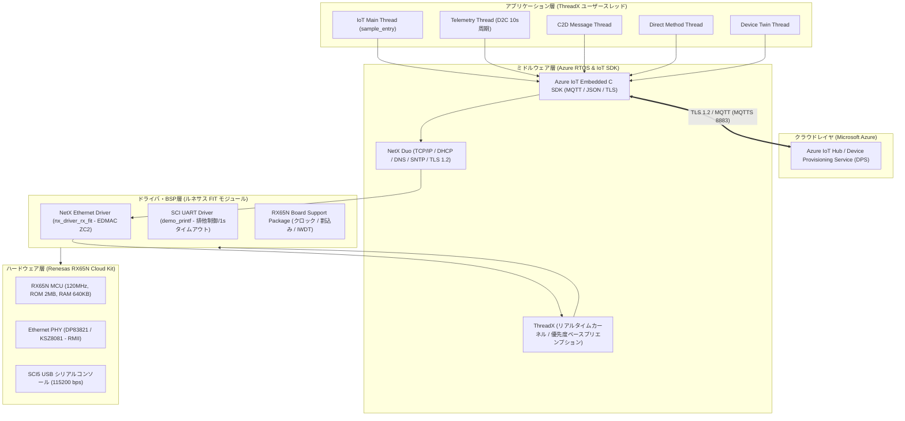

# Renesas RX65N Cloud Kit - Azure RTOS & Azure IoT Hub

[](https://www.renesas.com/products/microcontrollers-microprocessors/rx-32-bit-performance-efficiency-mcus/rx65n-651-32-bit-microcontrollers)
[-0078D4.svg)](https://github.com/azure-rtos)
[](https://azure.microsoft.com/services/iot-hub/)
[](LICENSE)

本リポジトリは、ルネサス エレクトロニクス製 32bit マイコン **RX65N (R5F565NEDDFB)** を対象とし、Microsoft **Azure RTOS (ThreadX / NetX Duo / FileX)** および **Azure IoT Embedded C SDK** を統合した産業用 IoT エッジデバイス向けファームウェアの完全な実装および設計書一式を提供します。

---

## 1. システムアーキテクチャ概要

本システムは、ハードウェアからクラウド通信までを5つのレイヤに階層化し、高度なリアルタイム性とフォールトトレランスを実現しています。



---

## 2. 設計ドキュメント体系

プロジェクトのアーキテクチャ、基本設計、詳細実装仕様、および試験手順は以下の各ドキュメントに体系化されています。

| ドキュメント名 | 役割と主な記載内容 |
|:---|:---|
| 📄 [**DESIGN_SURVEY_REPORT.md**](DESIGN_SURVEY_REPORT.md) | **設計調査報告書**: リポジトリ全ファイルの網羅的4分類（A/B/C/D）、メモリ配置、コールバック関係、潜在リスク一覧。 |
| 📄 [**BASIC_DESIGN_SPECIFICATION.md**](BASIC_DESIGN_SPECIFICATION.md) | **基本設計書**: メモリマップ（ROM 2MB / RAM 640KB）、タスク優先度、EDMAC ゼロコピー方式、TLS 1.2 暗号スイート、フェイルセーフ仕様。 |
| 📄 [**DETAILED_DESIGN_SPECIFICATION.md**](DETAILED_DESIGN_SPECIFICATION.md) | **詳細設計書**: 各モジュール（`demo_printf`, `nx_driver_rx_fit`, バックオフ計算, IoT Hub タスク）の詳細フロー、状態遷移図、排他制御設計。 |
| 📄 [**TEST_SPECIFICATION.md**](TEST_SPECIFICATION.md) | **テスト仕様書・試験項目書**: 単体テスト（UT）、結合テスト（IT）、耐障害性・フォールトインジェクション試験（FT）の合否判定基準と実施要領。 |

---

## 3. 適用済みの重大バグ・脆弱性パッチ概要

実機運用においてシステム停止やセキュリティ障害を招く以下の重要課題について、修正パッチを適用済みです。

1. **TLS ルート CA 証明書の更新（Baltimore 満了対応）** ([`src/nx_azure_iot_cert.c`](src/nx_azure_iot_cert.c))
   - 2025年5月12日に失効した DigiCert Baltimore Root を完全無効化し、2038年まで有効な **DigiCert Global Root G2** をプライマリ CA として適用。
2. **EDMAC 送信ヘッダの非アライメント境界違反解消** ([`src/nx_driver_rx_fit.c`](src/nx_driver_rx_fit.c))
   - `(ULONG *)(packet_ptr->nx_packet_prepend_ptr - 2)` による 2バイト整列不正キャストおよび構造体アンダーランを廃止し、バイト単位コピー（`memcpy`）による安全な 14バイト Ethernet ヘッダ構築へ変更。
   - ISR/タスク間共有フラグに `volatile ULONG deferred_events_flags;` を適用。
3. **シリアル出力のバッファオーバーランおよびデッドロック防止** ([`src/demo_printf.c`](src/demo_printf.c))
   - `vsnprintf` 出力の上限クリップ（255バイト制限＋終端 `\0` 保証）。
   - SCI 送信エラー時のセマフォ待機スキップおよびセマフォ待機タイムアウト（1秒）を設定し、永久デッドロックを防止。
4. **指数バックオフの 32bit 符号付き整数オーバーフロー防止** ([`src/sample_azure_iot_embedded_sdk_connect.c`](src/sample_azure_iot_embedded_sdk_connect.c))
   - `(1 << retry_count)` で `retry_count >= 31` 時に発生する未定義動作（負数化）を、リトライ回数上限（8回）クリップおよび `1ULL` 64bit シフトで防止。
5. **ネットワーク再接続ステータスの同期伝播** ([`src/sample_azure_iot_embedded_sdk.c`](src/sample_azure_iot_embedded_sdk.c))
   - `sample_connection_monitor` の引数をポインタ渡しに変更し、再接続成功時に `sample_connection_status = NX_SUCCESS` を確実に更新。各ワーカタスクの永久スリープを解消。

---

## 4. 開発環境要件

- **ターゲットハードウェア**:
  - Renesas RX65N Cloud Kit (Y-RX65N-CLOUD-KIT) または Envision Kit
  - MCU: R5F565NEDDFB (120MHz, ROM 2MB, RAM 640KB)
  - 通信ポート: オンボード Ethernet (RMII) 10/100 Mbps, USB-UART (SCI5)
- **統合開発環境 (IDE)**:
  - Renesas e2 studio (2023-04 以降推奨)
- **クロスコンパイラ**:
  - GCC for Renesas RX 14.2.0.202411 (または CC-RX v3.05 以降)
- **デバッガ / エミュレータ**:
  - Renesas E2 Emulator Lite / SEGGER J-Link on-board

---

## 5. ビルドおよび実行手順

### 5.1 リポジトリのクローン
```bash
git clone https://github.com/kumata93/RenesasRXAzureIoT.git
cd RenesasRXAzureIoT
```

### 5.2 接続情報の設定 (`sample_config.h`)
[`src/sample_config.h`](src/sample_config.h) を開き、ご使用の Azure IoT Hub 接続パラメータを設定します。

```c
/* Direct Connection (IoT Hub Host Name & Device ID) */
#define HOST_NAME       "your-iothub-name.azure-devices.net"
#define DEVICE_ID       "your-rx65n-device-id"

/* Authentication (Symmetric Key) */
#define DEVICE_SYMMETRIC_KEY    "your-device-primary-symmetric-key"
```

### 5.3 ビルド手順 (e2 studio)
1. e2 studio を起動し、ワークスペースを開きます。
2. `File` $\to$ `Import...` $\to$ `General` $\to$ `Existing Projects into Workspace` を選択し、本リポジトリのルートディレクトリを指定してインポートします。
3. プロジェクトツリーでプロジェクトを右クリック $\to$ `Build Project` を実行します。
4. `HardwareDebug/azure_sdk.elf` が正常に生成されたことを確認します。

### 5.4 フラッシュ書き込みとデバッグ実行
1. ターゲットボードの Ethernet ポートに LAN ケーブルを接続し、USB デバッグポートを PC に接続します。
2. PC 側でシリアルターミナル（Tera Term 等）を起動します（`115,200 bps`, `8bit`, `Parity None`, `Stop 1bit`）。
3. e2 studio にて `azure_sdk HardwareDebug.launch` を選択し、デバッグを開始します（`F8` で実行）。
4. コンソールに以下のような起動ログが出力されることを確認します。

```text
Starting NetX Azure IoT Hub Client...
IP address: 192.168.1.100
Mask: 255.255.255.0
Gateway: 192.168.1.1
DNS Server: 192.168.1.1
SNTP Time: 1773295800 (Synchronized)
IoTHub Host Name: your-iothub-name.azure-devices.net; Device ID: your-rx65n-device-id.
Connected to IoTHub.
Telemetry message sent: {"Message ID":0}
Telemetry message sent: {"Message ID":1}
```

---

## 6. ビルド・環境に関する注意事項

1. **`double` 型のサイズ設定**:
   - Azure SDK および JSON パーサーで 64bit 浮動小数点数を正しく扱うため、GCC プロジェクトのビルドオプションには `-m64bit-doubles` が設定されています（CC-RX の場合は `-dbl_size=8`）。
2. **リンカスクリプトのセクション削除抑止**:
   - GCC 最適化オプション `-Os`（サイズ最適化）を使用する場合、必要なセクションの意図しない削除を防ぐため、リンカオプションに `-Wl,--no-gc-sections` を付与してください。
3. **リンカスクリプト `_end` シンボルの位置**:
   - [`src/linker_script.ld`](src/linker_script.ld) の `.bss` セクション末尾に `_end = .;` が配置されている必要があります。ヒープ領域の基点として正しく認識されていることを確認してください。
4. **SCI ピンアサイン確認 (Smart Configurator)**:
   - スマートコンフィギュレータ（`.scfg`）を再生成した際、SCI5 の端子機能が `SMISO` / `SMOSI` に誤設定される場合があります。必ず `RXD5` / `TXD5` が割り当てられていることを確認してください。

---

## 7. ライセンス
本ソフトウェアは、Microsoft Azure RTOS ソフトウェアライセンス条項（EULA）に基づいて提供されています。詳細については [LICENSE](LICENSE) ファイルをご参照ください。
